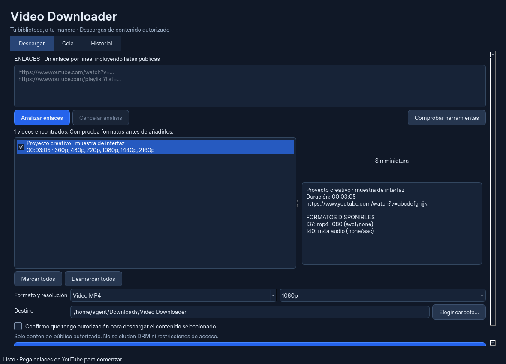

# Video Downloader

La solución web de este proyecto se usa enteramente desde el navegador: no
requiere instalar programas en el dispositivo ni mantener el ordenador encendido.
Google Sites puede insertar la página del servicio FastAPI alojado en la nube o
enlazar a ella directamente. El servicio aún no está desplegado y no hay una URL
pública de producción.

## Servicio web para Google Sites

La rama `feat/google-sites-web` incluye una interfaz HTML, CSS y JavaScript en
español, un backend FastAPI y un worker que reutiliza yt-dlp/FFmpeg del proyecto.
Analiza enlaces individuales públicos, ofrece MP4/MP3 y las calidades disponibles,
muestra el estado del trabajo y permite descargar el archivo desde el navegador.
Solo debe procesar contenido para el que el usuario tenga autorización; no evita
DRM ni restricciones de acceso.

El backend se aloja por separado en Linux con Docker Compose. Sigue
[la guía de publicación, inserción en Sites y costes](docs/google-sites-web/DEPLOYMENT.md),
[los controles de seguridad](docs/google-sites-web/SECURITY.md) y
[las pruebas y verificaciones](docs/google-sites-web/VALIDATION.md). GitHub guarda
el código; Google Sites solo presenta el sitio remoto. No se ha probado una
descarga real ni una inserción en una página de producción.

## Aplicación de escritorio existente (independiente)

El repositorio también conserva la aplicación de escritorio preexistente para
Windows. Esa aplicación no forma parte del nuevo flujo web y se mantiene separada.

### Funciones de escritorio

- Análisis de videos y listas públicas: título, duración, miniatura y formatos.
- MP4 con altura exacta de 360p, 480p, 720p, 1080p, 1440p o 2160p/4K, si existe.
- Extracción MP3 a 192 kbps con FFmpeg.
- Cola secuencial, cancelación, errores por trabajo, bytes, velocidad y ETA.
- Destino configurable y nombres Windows sin sobrescribir descargas anteriores.
- Historial SQLite y exportación CSV con la biblioteca estándar, sin pandas.



### Instalación de la aplicación de escritorio en Windows

Recomendado: Windows 10/11 x64 y Python 3.13 x64; mínimo Python 3.11.
Instala Python desde https://www.python.org/downloads/windows/ con el lanzador `py`.
Instala FFmpeg **y FFprobe**, y Node.js 24 LTS. Alternativa: Deno >=2.3.0.
La versión fijada de yt-dlp requiere Node >=22 para su soporte JavaScript.
Fuentes: https://ffmpeg.org/download.html, https://nodejs.org/, https://deno.com/.

Opcionalmente utiliza los paquetes oficiales de Winget:

```powershell
winget install --id Gyan.FFmpeg --exact
winget install --id OpenJS.NodeJS.LTS --exact
```

Reabre la terminal y comprueba:

```powershell
ffmpeg -version
ffprobe -version
node --version
```

Desde la carpeta del repositorio:

```powershell
py -3 -m venv .venv
.venv\Scripts\Activate.ps1
python -m pip install -r requirements.txt
python -m pip install --no-deps .
python -m video_downloader
```

También puedes ejecutar `instalar_dependencias.bat` y luego `ejecutar_gui.bat`.
Los BAT no instalan Python ni herramientas del sistema automáticamente.
Si PowerShell bloquea la activación, utiliza directamente
`.venv\Scripts\python.exe -m video_downloader`.

### Funcionamiento de la aplicación de escritorio

1. Pega enlaces de YouTube, uno por línea, y pulsa **Analizar enlaces**.
2. Revisa los metadatos y marca los videos deseados.
3. Elige MP4 y resolución o MP3, y la carpeta de destino.
4. Confirma que tienes autorización y añade la selección a la cola.
5. Consulta el progreso o cancela en **Cola**; revisa los resultados en **Historial**.

Un enlace `watch?v=…&list=…` analiza solo ese video. Para una lista completa utiliza
`youtube.com/playlist?list=…`. Límite: 100 URLs por análisis y 200 entradas por lista.
No se admiten emisiones en directo, futuras ni contenido privado, no listado o
que requiera autenticación. Las listas con entradas inaccesibles dan un error
explícito: usa enlaces individuales de los videos públicos accesibles.

Si la resolución no existe en un video marcado, debes elegir otra o desmarcarlo.
Las alturas son exactas: no se escala ni se cambia de calidad silenciosamente.
Los tamaños verticales distintos no se presentan como alturas horizontales.
Si cambia la disponibilidad después del análisis, el trabajo falla y la cola continúa.

Las descargas se guardan en subcarpetas exclusivas `VD-…`. Se sanea el nombre para
Windows y se limita su longitud; el destino en Windows no puede superar 120 caracteres.
Los parciales de cancelaciones controladas se limpian. Un apagado forzado puede dejar
una carpeta incompleta que puedes borrar manualmente. La cola pendiente no se restaura.

FFmpeg une pistas en MP4 o convierte otros contenedores a H.264/AAC. Un MP4 ya
existente puede conservar sus codecs y necesitar un reproductor actualizado.
MP3 se extrae a 192 kbps; esto no mejora la calidad de una fuente inferior.
Durante el posprocesamiento el progreso es indeterminado. El porcentaje puede
reiniciarse entre pistas. El análisis cancelado espera la solicitud de red en curso;
las descargas se cancelan terminando el árbol de procesos, incluido FFmpeg.

**Comprobar herramientas** muestra versiones en un worker sin bloquear la interfaz.
Los mensajes distinguen problemas de red, limitación de solicitudes, restricciones
y formatos ausentes. No se proporcionan cookies, credenciales ni mecanismos de acceso.
La confirmación de autorización es una declaración del usuario, no una verificación
jurídica automática.

### Desarrollo y verificaciones de escritorio

```powershell
python -m pip install -r requirements-dev.txt
python -m pip install --no-deps -e .
python -m pip check
ruff check src tests scripts app.py gui.py desktop.py
ruff format --check src tests scripts app.py gui.py desktop.py
mypy
python scripts/check_runtime.py
$env:QT_QPA_PLATFORM = "offscreen"
python -m pytest -q
python scripts/smoke_ui.py
python -m video_downloader --smoke-test
```

En Linux usa `QT_QPA_PLATFORM=offscreen python -m pytest -q` e instala FFmpeg/FFprobe
por el gestor del sistema. Las pruebas Qt no necesitan pantalla real.
`--smoke-test` abre/cierra la ventana y comprueba imports e IPC de un proceso `spawn`,
sin consultar YouTube ni escribir en el historial de usuario.

Las pruebas simulan YouTube y la red. Las integraciones FFmpeg usan archivos
sintéticos y FFprobe. Si faltan FFmpeg/FFprobe, esas dos pruebas se omiten
explícitamente; no equivale a validación completa. Consulta
[el informe](docs/VALIDATION.md) y [la arquitectura](docs/ARCHITECTURE.md).

### Ejecutable de la aplicación de escritorio existente

PyInstaller debe ejecutarse **en Windows**: no compila Windows desde Linux.

### GitHub Actions

Publica la rama en GitHub y ejecuta **Tests and Windows build** desde Actions, o
haz push/PR. Tras las pruebas de Linux/Windows en Python 3.11/3.13, `windows-build`
compila y hace un arranque offline del ejecutable que comprueba también `spawn`.
Descarga el artefacto **VideoDownloader-Windows-x64**, extrae **todo** el ZIP y abre
`VideoDownloader.exe`.

El artefacto predeterminado no incluye FFmpeg/FFprobe ni Node/Deno: instálalos en
PATH o coloca sus ejecutables en `tools` junto a `VideoDownloader.exe`.
No muevas solo el `.exe`: necesita `_internal` y los demás archivos de su carpeta.

### Compilación local

Con las dependencias de desarrollo instaladas en Windows:

```powershell
./scripts/build_windows.ps1
./dist/VideoDownloader/VideoDownloader.exe
```

La opción `-ToolsDirectory C:\MisHerramientas` copia `ffmpeg.exe`, `ffprobe.exe` y
`node.exe` desde esa carpeta. Distribuir esas herramientas exige conservar sus
licencias, avisos y obligaciones de código fuente correspondientes a cada build;
consulta [THIRD_PARTY.md](THIRD_PARTY.md). Sin esa opción no se empaquetan.
El ejecutable no está firmado. Antes de distribuirlo públicamente, valida en una
VM limpia de Windows, revisa licencias y firma con Authenticode.

### Mantenimiento y publicación de escritorio

`pyproject.toml` declara dependencias; `requirements.txt` y `requirements-dev.txt`
fijan versiones, incluidos los extras recomendados de yt-dlp y EJS. Dependabot
propone actualizaciones de paquetes y Actions. Para actualizar:

```powershell
pip-compile --upgrade --strip-extras -o requirements.txt pyproject.toml
pip-compile --upgrade --extra dev --strip-extras -o requirements-dev.txt pyproject.toml
```

Regenera preferentemente en Windows para conservar `pefile` y `pywin32-ctypes`.
El lock actual se resolvió en Linux y añade estas dependencias con marcadores de
Windows. Revisa los cambios y repite pruebas y compilación. No se autoactualiza
yt-dlp dentro del ejecutable. YouTube puede cambiar aunque las simulaciones pasen.

La rama es `feat/video-downloader-desktop`. No se publica ni crea una release
automáticamente. Revisa el PR, ejecuta el workflow, prueba manualmente contenido
propio/autorizado en Windows y adjunta el ZIP completo a una release.
